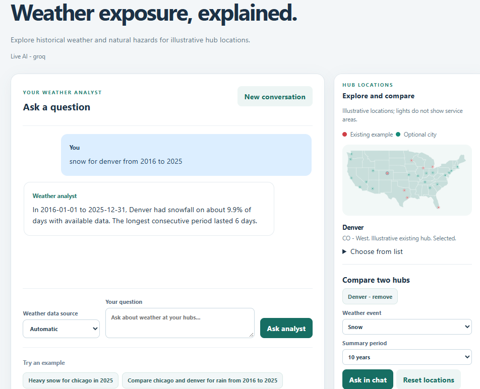
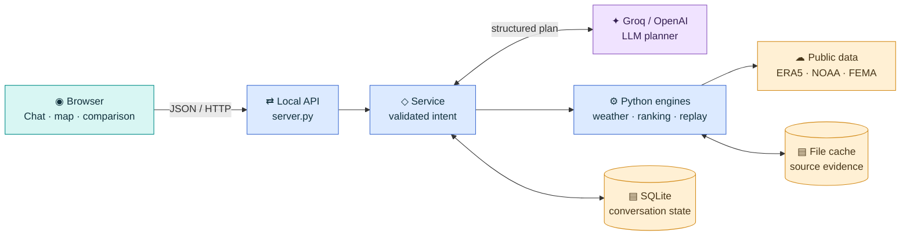

# Weather Risk Intelligence Agent

A local conversational application for exploring historical weather exposure and comparing illustrative US hub locations. The AI model interprets questions through a validated structured schema; Python calculates the weather metrics and planning scores.

## Run the app

Install Python 3.11 or newer, then from the project directory run:

```sh
python -m pip install -r requirements.txt
python scripts/start_live.py --port 8793
```

Open [http://127.0.0.1:8793](http://127.0.0.1:8793) and keep the terminal open. The launcher uses Groq by default. It reads the first Groq key in the Git-ignored `keys.local.md`, then `GROQ_API_KEY` if that file has no key, or prompts for a key without displaying it. Keys stay out of the browser and source control. The launcher does not open a browser automatically.

Choose another port with `python scripts/start_live.py --port PORT`. For OpenAI use `--provider openai --model MODEL`. Use `--weather-source noaa` to choose NOAA as the default weather source. Stop the server with Ctrl+C. Restart after changing Python code; if a port is already occupied, stop the old server or choose another port.

To try the application without an AI key, run `python -m app.server --demo`. Demo mode uses a limited keyword parser, while weather data still comes from real public sources or local caches. The Windows PowerShell alternative is `scripts/start-live.ps1`; see [model providers](docs/model-providers.md).

## Use the interface



Ask a question in chat or select up to two cities on the map. Choose a weather event and period, then use **Ask in chat** or **Compare in chat** to prepare an editable question. **Full comparison table** displays the selected event for the last 5, 10, 20 and 30 complete years. **Reset locations** keeps the conversation and previous table.

Examples:

- `Heavy snow for chicago in 2025`
- `Compare chicago and denver for rain from 2016 to 2025`
- `Which hubs in the Midwest are most exposed to winter disruption?`
- `Compare miami and houston for hurricane and flood risk`

See [example questions](docs/example-questions.md) for the supported definitions, follow-ups and limitations. The catalog in [app/hubs.json](app/hubs.json) contains 25 illustrative locations, including seven example existing hubs. Edit it and restart the server to change them. They are not verified facilities or demonstrated service areas; the map shows the contiguous US.

## How comparisons work

For supported measures, the illustrative 0-100 planning index combines frequency (default 50%), severity (25%) and assumed recovery (25%). Thresholds, weights and recovery assumptions are adjustable. A lower index indicates lower modeled exposure under those assumptions; the index is **not** a probability of closure or predicted downtime.

When comparable frequency and severity evidence is insufficient for a selected hazard, the application explains the partial result and can use FEMA county expected annual loss scores as a fallback. FEMA scores rank county-level expected losses relative to other counties; they are not percentages or facility-specific probabilities. Hurricane, inland flood and coastal flood are considered separately. Available NOAA event counts are reported with their geographic and reporting limitations. The sources and assumptions do not establish which specific facility or backup network is safest.

Data sources include Open-Meteo ERA5 reanalysis, NOAA GHCN-Daily station observations, NOAA Storm Events reports, and FEMA's National Risk Index. The weather source selector supports automatic fallback, Open-Meteo only or NOAA station observations only. NOAA station observations do not supply the app's maximum wind metric. Coverage varies by location and period; NOAA event archive years do not guarantee complete reporting. See [weather sources](docs/weather-sources.md).

## Public data sources

- [Open-Meteo Historical Weather API](https://open-meteo.com/en/docs/historical-weather-api): ERA5 gridded reanalysis for historical daily weather. This is modeled weather, not an on-site sensor.
- [NOAA GHCN-Daily](https://www.ncei.noaa.gov/products/land-based-station/global-historical-climatology-network-daily): station observations used as an independent fallback for supported daily variables. The app does not use NOAA fallback for maximum wind.
- [NOAA Storm Events Database](https://www.ncei.noaa.gov/stormevents/): reported events used for county or state comparisons; reporting coverage and geographic scope vary.
- [FEMA National Risk Index technical documentation](https://www.fema.gov/sites/default/files/documents/fema_national-risk-index_technical-documentation.pdf): county-level natural hazard expected annual loss scores used as a fallback in supported comparisons, not facility-specific losses.

### FEMA fallback scoring

For a **two-hub comparison**, if one or more requested supported event hazards cannot be included in the app's index, the service attempts to fetch FEMA scores for both hub counties. The supported fallback event types are hurricane, flood or flash flood, ice storm, tornado and drought. Flood maps to inland and coastal flood scores where available. The comparison requires both counties to have the same FEMA dataset version and a score for the hazard; otherwise the fallback is reported as unavailable for that comparison.

The app presents the FEMA **expected annual loss score** as a separate county-level comparison for the excluded hazard. A higher score indicates higher relative expected annual loss among counties. It is not a percentage, a facility shutdown probability, or a direct substitute for the app's frequency/severity/recovery index. FEMA scores are not restricted to the selected NOAA reporting period. When other hazards have enough evidence, their planning-index results may still be shown alongside the clearly labeled fallback.

## Groq free-tier limits

Groq's [rate-limit table](https://console.groq.com/docs/rate-limits) lists `openai/gpt-oss-20b` at **30 requests/minute, 1,000 requests/day, 8,000 tokens/minute and 200,000 tokens/day** in its published high-level table, checked 3 November 2026. These are reference limits, not a guarantee for this account: Groq says exceptions apply and its account Limits page shows the exact organization limits. A project may impose a lower limit. Input and output tokens both matter, so a token cap can stop requests before the request count is reached. Shared organization usage also consumes available capacity.

When a limit is hit, Groq returns HTTP 429. Wait for the indicated reset or retry time and reduce request frequency; check the account's Limits and Usage pages. The app does not automatically switch to another provider or demo mode. Developer plan capacity is higher but usage is billed; do not assume the free tier is unlimited. See [Groq rate limits](https://console.groq.com/docs/rate-limits) and [billing FAQ](https://console.groq.com/docs/billing-faqs).

## Tests and evaluation

```sh
python -m unittest discover -s tests
python -m evals.run
```

The conversation evaluation uses synthetic weather and event data. `python -m evals.run --live-model` additionally calls the configured AI provider and may incur charges. The most recent complete run passed 100 unit tests and 14 demo evaluation cases. The current interface and expanded evaluation have not been fully verified end to end with a live model.

## System architecture



1. **Interface and API.** `app/static/` provides a same-origin browser interface. `app/server.py` serves it and routes JSON requests, including chat, hub comparison, scenario replay and network comparison. The standard-library server listens on `127.0.0.1` for a local, single-user demo.
2. **Planning and validation.** `app/agent.py` coordinates a request and conversation context. `app/providers.py` sends the question, prior intent and catalog to Groq or OpenAI. The provider returns a structured plan, which `app/schemas.py` validates before the service dispatches an approved action. The opt-in demo parser is deterministic and has limited language support.
3. **Data and analysis.** `app/weather_sources.py` selects Open-Meteo ERA5 or NOAA GHCN-Daily station data. In auto mode, a primary service failure triggers a whole-analysis NOAA retry to avoid silently mixing sources. `app/weather.py`, `app/noaa.py`, `app/storm_events.py` and `app/fema.py` retrieve or process historical and county-level evidence. `app/hub_comparison.py` computes frequency, severity and assumed recovery into a configurable, non-probabilistic planning index. Weather analysis, scenario allocation and the resulting explanations are deterministic Python, not LLM-generated arithmetic.
4. **Results and context.** The service returns an answer, metrics and provenance to the browser and saves the resolved conversation context. The user can ask a follow-up or inspect the assumptions and evidence. A separate replay API uses explicitly supplied hubs, demand and links; `app/scenarios.py` allocates capacity and `app/winter.py` applies an illustrative snowfall and recovery profile.

## Data storage

- **SQLite** (`data/app.sqlite3`) holds per-conversation state and stored locations. The active catalog is loaded from `app/hubs.json` at startup; old stored locations can remain inactive. The database does not preserve a complete conversation transcript.
- **Files under `data/cache/`** retain source responses and provenance for repeatable retrieval. Weather cache envelopes include request URL, retrieval time and SHA-256; NOAA has its own cached source files. Runtime data and credentials are excluded from Git.
- This lightweight local storage avoids an external database for the take-home demo. Multi-user operation, durable deployment and access controls would require additional design.

## Repository structure

```text
app/
  server.py                 HTTP routes and static file serving
  agent.py, schemas.py      orchestration and validated intent/contracts
  providers.py              Groq and OpenAI planning adapters
  weather*.py, noaa.py     weather retrieval, selection and analytics
  storm_events.py, fema.py reported-event and county-hazard sources
  hub_comparison.py         multi-period hub comparisons and index
  scenarios.py, winter.py   allocation, disruption and recovery model
  comparison.py             reference vs. candidate network comparison
  storage.py, hubs.json     SQLite state and active location catalog
  static/                   browser UI, styling and map boundaries
tests/                      unit and integration-style tests
evals/                      conversation cases and evaluation runner
scripts/                    local live-mode launchers
docs/                       assumptions, source notes and project details
data/                       local runtime database and caches
README.md                   setup, API and usage instructions
```

## API and project structure

The browser calls the local API served by [app/server.py](app/server.py). Key routes include `GET /api/health`, `GET /api/locations`, `POST /api/chat` and `POST /api/hub-comparison`. Network replay and comparison are available through `POST /api/scenarios/replay` and `POST /api/scenarios/compare` with explicit network inputs; they do not automatically optimize a real network. The local server binds to loopback and is not configured for public production deployment.

- [app/](app/): interface, API, model planning, deterministic analysis and data adapters.
- [tests/](tests/) and [evals/](evals/): automated checks and conversation evaluation.
- [docs/](docs/): [architecture](docs/assignment-materials/architecture.md), [presentation](docs/assignment-materials/weather-agent-submission.pptx), [assumptions](docs/assumptions.md), [example questions](docs/example-questions.md), and [source descriptions](docs/weather-sources.md).
- [codex-session-01a19cd3-67dd-7c80-974f-0929d282c993.md](codex-session-01a19cd3-67dd-7c80-974f-0929d282c993.md): exported development session with the shared Groq key redacted.

Runtime caches, the local database, evaluation reports and `keys.local.md` are ignored by Git. Cached NOAA storm archives can be large and are useful for offline comparisons; they are not included in the repository.

## Potential improvements

1. **Calibrate against operations:** replace illustrative hubs and assumptions with verified facility locations, actual closures, capacity losses and recovery records; validate the index against observed outcomes.
2. **Improve hazard and network evidence:** incorporate facility-level flood and hurricane exposure, transport disruption data, realistic route times and demand or population coverage. Model backlog explicitly if needed.
3. **Strengthen evaluation:** run the expanded live-model cases and current UI end to end, test ambiguous follow-ups and source failures, and measure planning accuracy and latency across models.
4. **Prepare for real deployment:** add authentication, a production server, multi-user storage, monitoring, scheduled alerts and operational controls. Verify data-provider usage terms before commercial use.
5. **Improve decision support:** add sensitivity analysis for weights and assumptions, validated uncertainty measures, and investment-cost inputs before suggesting a resilience investment.
