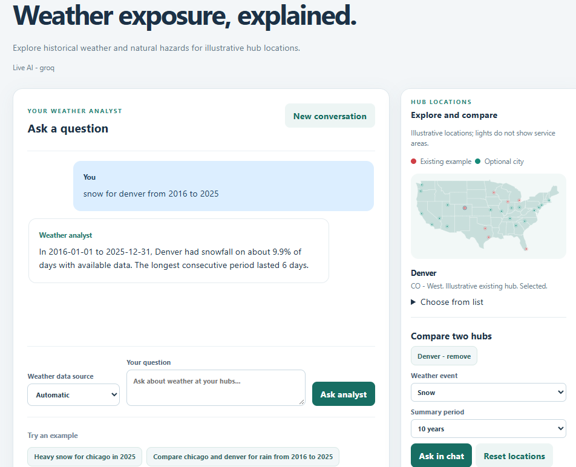
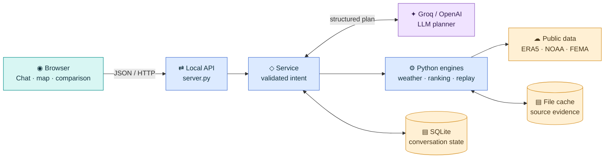

# Weather Risk Intelligence Agent: Architecture

This local prototype helps an analyst explore historical weather exposure, compare illustrative hubs, and replay an explicitly supplied network under assumed snow disruptions. A language model interprets questions; deterministic Python validates the plan, computes results and constructs the explanation.

## Run the live agent

1. Install Python 3.11+ and the dependencies from the repository root: `python -m pip install -r requirements.txt`.
2. Obtain a Groq API key from [Groq Console](https://console.groq.com/keys). From the repository root run:

```powershell
python scripts/start_live.py --port 8793
```

3. If `GROQ_API_KEY` is unset, enter the key at the hidden prompt. Open [http://127.0.0.1:8793](http://127.0.0.1:8793) in your browser and ask, for example, “Snow for denver in 2025.” Keep the terminal open; press Ctrl+C to stop.



The screenshot shows a sample Denver snowfall question on the left and the hub map and comparison controls on the right. The response is an example from the captured session.

The default is Groq `openai/gpt-oss-20b` with `WEATHER_SOURCE=auto`. The key is passed to the child process, not saved by the launcher. The live model and public weather services require network access. To exercise the limited, non-LLM parser without a model key, run `python -m app.server --demo --port 8793`; weather retrieval still uses real data or cache.

## Groq free-tier limits

Groq's [rate-limit table](https://console.groq.com/docs/rate-limits) lists `openai/gpt-oss-20b` at **30 requests/minute, 1,000 requests/day, 8,000 tokens/minute and 200,000 tokens/day** in its published high-level table, checked 3 November 2026. These are reference limits, not a guarantee for this account: Groq says exceptions apply and its account Limits page shows the exact organization limits. A project may impose a lower limit. Input and output tokens both matter, so a token cap can stop requests before the request count is reached. Shared organization usage also consumes available capacity.

When a limit is hit, Groq returns HTTP 429. Wait for the indicated reset or retry time and reduce request frequency; check the account's Limits and Usage pages. The app does not automatically switch to another provider or demo mode. Developer plan capacity is higher but usage is billed; do not assume the free tier is unlimited. See [Groq rate limits](https://console.groq.com/docs/rate-limits) and [billing FAQ](https://console.groq.com/docs/billing-faqs).

## System architecture



1. **Interface and API.** `app/static/` provides a same-origin browser interface. `app/server.py` serves it and routes JSON requests, including chat, hub comparison, scenario replay and network comparison. The standard-library server listens on `127.0.0.1` for a local, single-user demo.
2. **Planning and validation.** `app/agent.py` coordinates a request and conversation context. `app/providers.py` sends the question, prior intent and catalog to Groq or OpenAI. The provider returns a structured plan, which `app/schemas.py` validates before the service dispatches an approved action. The opt-in demo parser is deterministic and has limited language support.
3. **Data and analysis.** `app/weather_sources.py` selects Open-Meteo ERA5 or NOAA GHCN-Daily station data. In auto mode, a primary service failure triggers a whole-analysis NOAA retry to avoid silently mixing sources. `app/weather.py`, `app/noaa.py`, `app/storm_events.py` and `app/fema.py` retrieve or process historical and county-level evidence. `app/hub_comparison.py` computes frequency, severity and assumed recovery into a configurable, non-probabilistic planning index. Weather analysis, scenario allocation and the resulting explanations are deterministic Python, not LLM-generated arithmetic.
4. **Results and context.** The service returns an answer, metrics and provenance to the browser and saves the resolved conversation context. The user can ask a follow-up or inspect the assumptions and evidence. A separate replay API uses explicitly supplied hubs, demand and links; `app/scenarios.py` allocates capacity and `app/winter.py` applies an illustrative snowfall and recovery profile.

## Data storage

- **SQLite** (`data/app.sqlite3`) holds per-conversation state and stored locations. The active catalog is loaded from `app/hubs.json` at startup; old stored locations can remain inactive. The database does not preserve a complete conversation transcript.
- **Files under `data/cache/`** retain source responses and provenance for repeatable retrieval. Weather cache envelopes include request URL, retrieval time and SHA-256; NOAA has its own cached source files. Runtime data and credentials are excluded from Git.
- This lightweight local storage avoids an external database for the take-home demo. Multi-user operation, durable deployment and access controls would require additional design.

## Public data sources

- [Open-Meteo Historical Weather API](https://open-meteo.com/en/docs/historical-weather-api): ERA5 gridded reanalysis for historical daily weather. This is modeled weather, not an on-site sensor.
- [NOAA GHCN-Daily](https://www.ncei.noaa.gov/products/land-based-station/global-historical-climatology-network-daily): station observations used as an independent fallback for supported daily variables. The app does not use NOAA fallback for maximum wind.
- [NOAA Storm Events Database](https://www.ncei.noaa.gov/stormevents/): reported events used for county or state comparisons; reporting coverage and geographic scope vary.
- [FEMA National Risk Index technical documentation](https://www.fema.gov/sites/default/files/documents/fema_national-risk-index_technical-documentation.pdf): county-level natural hazard expected annual loss scores used as a fallback in supported comparisons, not facility-specific losses.

### FEMA fallback scoring

For a **two-hub comparison**, if one or more requested supported event hazards cannot be included in the app's index, the service attempts to fetch FEMA scores for both hub counties. The supported fallback event types are hurricane, flood or flash flood, ice storm, tornado and drought. Flood maps to inland and coastal flood scores where available. The comparison requires both counties to have the same FEMA dataset version and a score for the hazard; otherwise the fallback is reported as unavailable for that comparison.

The app presents the FEMA **expected annual loss score** as a separate county-level comparison for the excluded hazard. A higher score indicates higher relative expected annual loss among counties. It is not a percentage, a facility shutdown probability, or a direct substitute for the app's frequency/severity/recovery index. FEMA scores are not restricted to the selected NOAA reporting period. When other hazards have enough evidence, their planning-index results may still be shown alongside the clearly labeled fallback.

## Potential improvements

1. **Calibrate against operations:** replace illustrative hubs and assumptions with verified facility locations, actual closures, capacity losses and recovery records; validate the index against observed outcomes.
2. **Improve hazard and network evidence:** incorporate facility-level flood and hurricane exposure, transport disruption data, realistic route times and demand or population coverage. Model backlog explicitly if needed.
3. **Strengthen evaluation:** run the expanded live-model cases and current UI end to end, test ambiguous follow-ups and source failures, and measure planning accuracy and latency across models.
4. **Prepare for real deployment:** add authentication, a production server, multi-user storage, monitoring, scheduled alerts and operational controls. Verify data-provider usage terms before commercial use.
5. **Improve decision support:** add sensitivity analysis for weights and assumptions, validated uncertainty measures, and investment-cost inputs before suggesting a resilience investment.


## Repository structure

```text
app/
  server.py                 HTTP routes and static file serving
  agent.py, schemas.py      orchestration and validated intent/contracts
  providers.py              Groq and OpenAI planning adapters
  weather*.py, noaa.py     weather retrieval, selection and analytics
  storm_events.py, fema.py reported-event and county-hazard sources
  hub_comparison.py         multi-period hub comparisons and index
  scenarios.py, winter.py   allocation, disruption and recovery model
  comparison.py             reference vs. candidate network comparison
  storage.py, hubs.json     SQLite state and active location catalog
  static/                   browser UI, styling and map boundaries
tests/                      unit and integration-style tests
evals/                      conversation cases and evaluation runner
scripts/                    local live-mode launchers
docs/                       assumptions, source notes and project details
data/                       local runtime database and caches
README.md                   setup, API and usage instructions
```

## Scope and evidence

The 25 catalog locations are illustrative, not verified company facilities. ERA5 is modeled historical weather; NOAA station and county/state event records have different geographic and reporting limits. Thresholds, recovery durations and index weights are planning assumptions, not actual closures, shutdown probabilities or financial losses. Missing data can prevent a complete ranking. The app does not establish nationwide coverage, optimize facilities, or model actual road/airport closures.

The repository reports automated tests and a small evaluation set. Its README records an earlier 7-case live-model evaluation and notes that expanded live-model and current-interface end-to-end checks remain pending. These materials describe the repository; they do not independently establish full assignment compliance. The assignment separately requires the full AI-development session; the repository README flags that export as outstanding.
